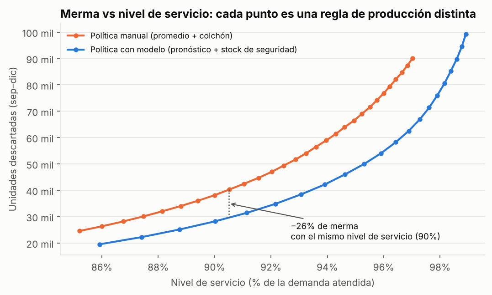
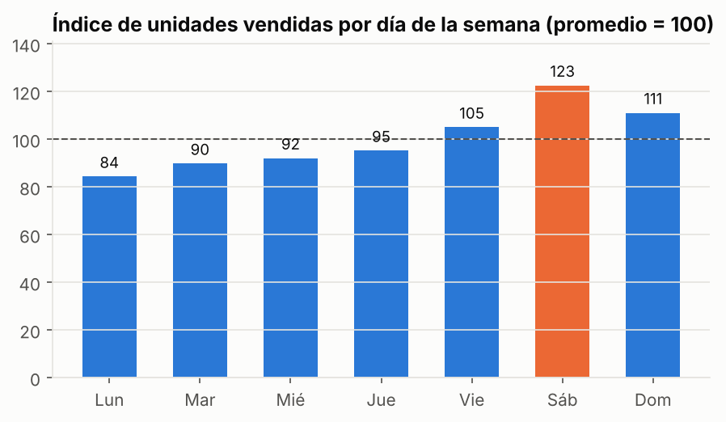
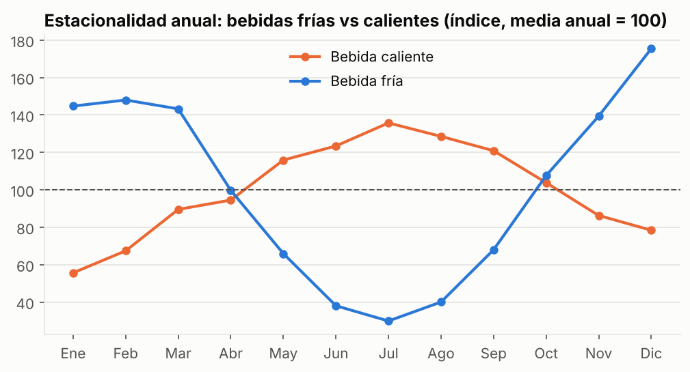
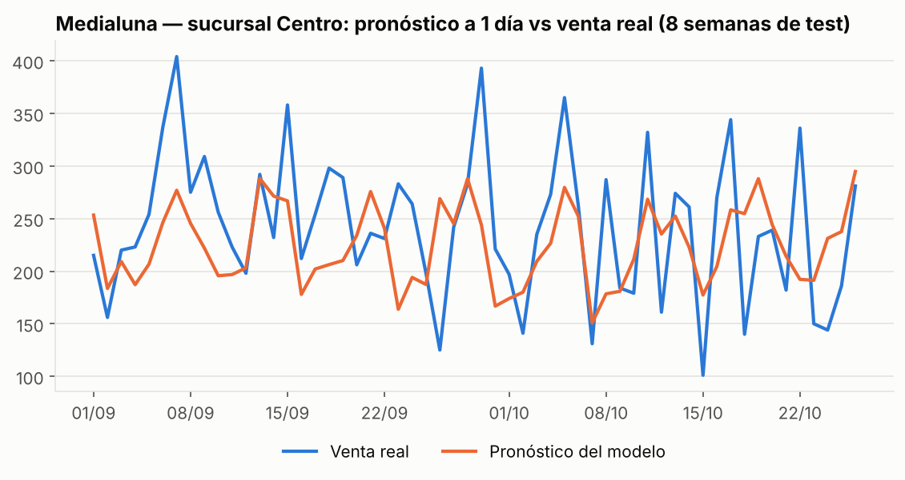

# Pronóstico de demanda y reducción de merma — cadena gastronómica


> 🇬🇧 **English summary:** Day-ahead demand forecasting for a 4-branch café chain using gradient boosting, plus an inventory simulation for perishable goods. At the **same service level** as the manual "last 4 weeks + 20% buffer" rule, the model-based production policy **cuts food waste by ~26%**.

## El problema

En una cafetería, lo que se produce a la mañana y no se vende a la noche se tira. La regla habitual es *"producir lo mismo que los últimos martes, más un 20% por las dudas"*. Esa regla no anticipa promociones, feriados ni cambios de estación: genera **merma** algunos días y **faltantes** otros.

**Pregunta:** ¿cuánto se reduce la merma si la producción diaria se decide con un modelo de pronóstico, sin vender menos?

## Resultados

| | Regla manual | Modelo | Mejora |
|---|---:|---:|---:|
| Error de pronóstico | 31,3% | **27,5%** | −3,8 pp |
| Merma de productos frescos | 40.323 u. | **29.691 u.** | **−26%** |
| Nivel de servicio | 90,5% | 90,5% | igual |
| Ahorro estimado en costo de mercadería | | | **≈ $1,47 M ARS / mes** |



*Cada punto es una regla de producción distinta. La curva del modelo (azul) queda por debajo en todo el rango: con cualquier nivel de servicio que elija el negocio, se tira menos.*

## Hallazgos del análisis exploratorio

| Día de la semana | Estacionalidad de bebidas |
|---|---|
|  |  |

- El **sábado** vende 23% más que el promedio; el **lunes**, 16% menos.
- Las bebidas frías venden casi 5 veces más en verano que en julio; las calientes tienen su pico en pleno invierno.
- Las **promociones** (−15% de precio) suben las unidades entre 30% y 36% según la categoría.



## Metodología

1. **Datos:** 35.088 registros diarios (2 años × 4 sucursales × 12 productos).
2. **Variables:** calendario (día, mes, estacionalidad seno/coseno), promociones, feriados de Argentina, rezagos de 1/7/14 días y medias móviles de 7 y 28 días.
3. **Modelo:** `HistGradientBoostingRegressor` con pérdida de Poisson (adecuada para conteos).
4. **Validación temporal estricta:** entrenamiento hasta agosto 2024; evaluación en sep–dic 2024. El stock de seguridad se calibra en jul–ago, **antes** del período de test, para no hacer trampa.
5. **Simulación de inventario:** para los 6 productos con vida útil de 1 día se comparan ambas políticas **al mismo nivel de servicio**, porque comparar solo la merma favorece a quien produce menos.

## Estructura

```
├── main.py                     # ejecuta todo y genera reports/
├── notebooks/
│   └── analisis_ventas.ipynb   # análisis narrado, con gráficos
├── src/
│   ├── generar_datos.py        # generador de datos sintéticos
│   ├── modelo.py               # features, entrenamiento y métricas
│   ├── inventario.py           # simulación de producción y merma
│   ├── pipeline.py             # orquestación
│   ├── graficos.py / estilo.py # visualizaciones
├── data/raw/                   # CSV generados
└── reports/                    # figuras, métricas y resumen.json
```

## Cómo ejecutarlo

```bash
git clone https://github.com/Lu1sPerez/analisis-ventas-gastronomia.git
cd analisis-ventas-gastronomia
python -m venv .venv && source .venv/bin/activate   # en Windows: .venv\Scripts\activate
pip install -r requirements.txt
python main.py                    # ~10 segundos
jupyter notebook notebooks/analisis_ventas.ipynb
```

## Sobre los datos

Los datos son **sintéticos**: los datos reales de ventas de una empresa son confidenciales. El generador (`src/generar_datos.py`) reproduce patrones que observé gestionando la operación de una cadena de 4 sucursales y un centro de producción: estacionalidad semanal y anual, efecto de promociones, feriados nacionales, vacaciones de enero y demanda sobre-dispersa (binomial negativa). La semilla es fija, así que los resultados son reproducibles.

**Limitaciones:** la demanda se asume no censurada (en la realidad, lo que no se vendió por falta de stock no queda registrado); no se modela el reaprovechamiento de sobrantes.

---
**Autor:** Luis Pérez · [LinkedIn](https://www.linkedin.com/in/perezluis24/) · Analista de Datos | BI | Automatización
